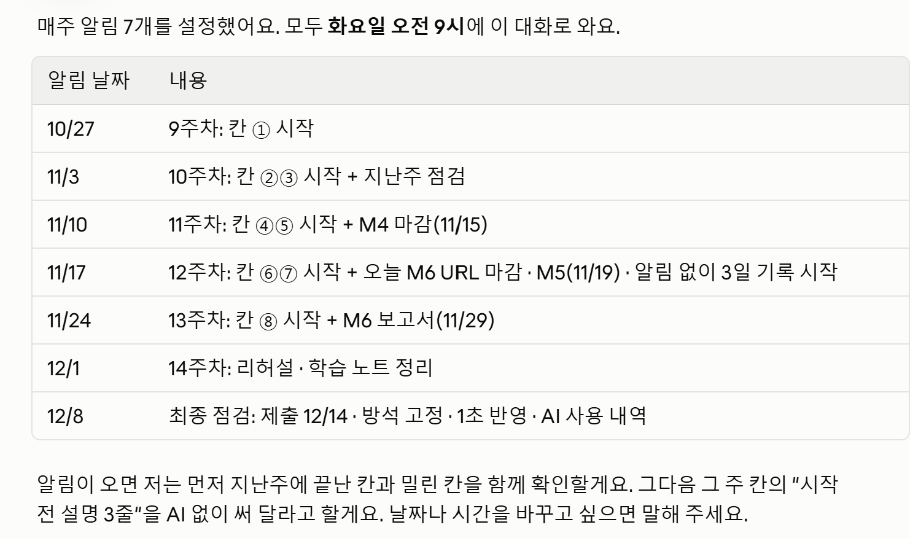

# 00 · Claude 튜터 설정 기록

## 지금 설정 — Claude Code (2026-10-18~)

관리를 한 곳에서 하려고 튜터를 이 저장소의 **Claude Code** 세션으로 옮겼다. 코드 · 측정 CSV · 학습 노트 · 캡처가 모두 저장소에 있어서, Claude가 파일을 바로 읽고 기록을 `learning/`에 정리한다.

| 무엇을 | 설정 |
|---|---|
| 튜터 지침 | 저장소 루트 [CLAUDE.md](../../CLAUDE.md) — 모든 세션에 자동 적용. 튜터 지침 · 파일을 고치는 규칙(①~⑧ 학습 코드는 내가 직접 쓰고 Claude는 힌트 · 리뷰만) · 칸별 계획 · 기록 정리 방법 · 일정 |
| 주간 알림 | Claude Code 예약 작업 7개, 매주 화요일 오전 9시 (아래 표). 앱이 꺼져 있으면 다음에 켤 때 실행된다 |
| 권한 | 세션은 "수정 전에 물어보기"로 둔다 — 학습 코드를 대신 고치지 못하게 |
| AI 사용 내역 | 칸이 끝나면 세션 기록을 내보내 그 칸 폴더에 저장 |

## 주간 알림 (Claude Code 예약 작업)

| 알림 날짜 | 작업 | 내용 |
|---|---|---|
| 10/27 | `pcomp-week09` | 9주차: 칸 ① 시작 |
| 11/3 | `pcomp-week10` | 10주차: 칸 ②③ 시작 + 지난주 점검 |
| 11/10 | `pcomp-week11` | 11주차: 칸 ④⑤ 시작 + M4 마감(11/15) |
| 11/17 | `pcomp-week12` | 12주차: 칸 ⑥⑦ 시작 + M6 URL 마감 · M5(11/19) · 알림 없이 3일 기록 시작 |
| 11/24 | `pcomp-week13` | 13주차: 칸 ⑧ 시작 + 알림 켜고 3일 비교 · M6 보고서(11/29) |
| 12/1 | `pcomp-week14` | 14주차: 리허설 · 학습 노트 전체 점검 |
| 12/8 | `pcomp-final-check` | 최종 점검: 제출 12/14 · 방석 고정 · 1초 반영 · AI 사용 내역 |

알림이 오면 Claude가 `learning/`에서 지난주에 끝난 칸과 밀린 칸을 먼저 확인하고, 그 주 칸의 "시작 전 설명 3줄"을 AI 없이 써 달라고 한다.

## 처음 설정 — Claude 프로젝트 (2026-10-18)

처음에는 Claude 프로젝트(claude.ai)에 같은 지침을 넣고 9~14주 계획과 알림을 정했다. 내용은 그대로 Claude Code로 옮겼다.

| 무엇을 | 결과 | 캡처 |
|---|---|---|
| 9~14주 실행 계획 | 9주차부터 시작으로 확정 | [plan-confirmed](2026-10-18_plan-confirmed.png) |
| 주간 알림 7개 | 매주 화요일 오전 9시, 10/27 ~ 12/8 (Claude Code 예약 작업으로 옮김) | [weekly-reminders](2026-10-18_weekly-reminders.png) |

